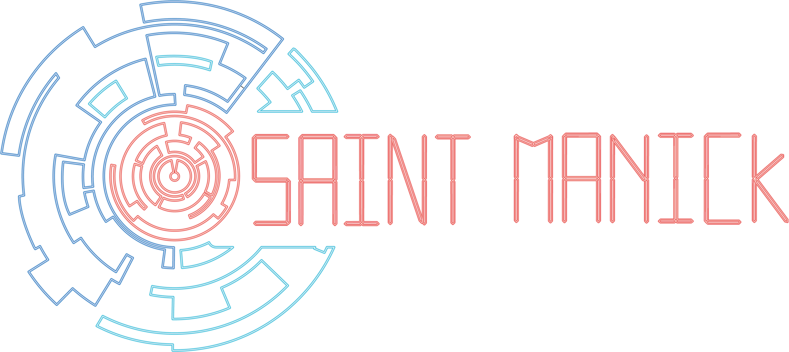
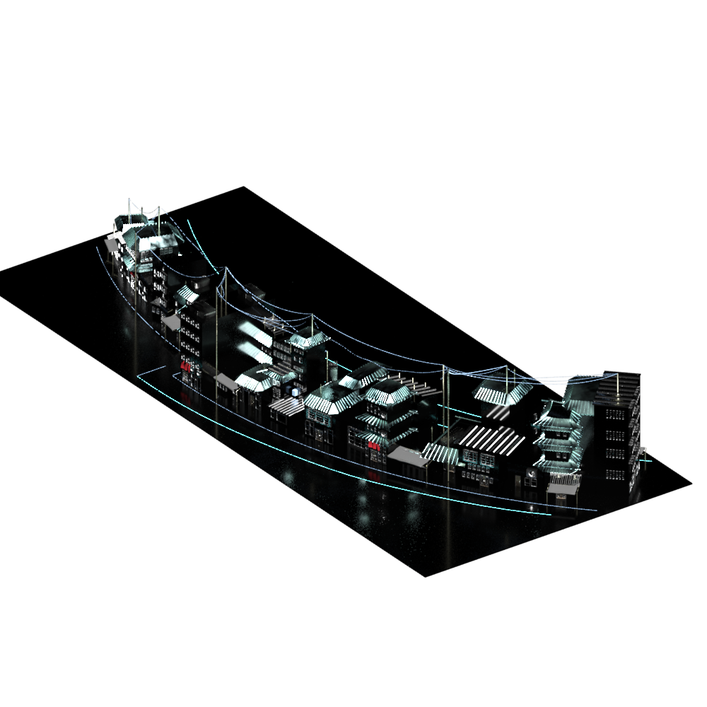

> [!IMPORTANT]  
> **MASTER SOURCE OF TRUTH**  
> This Game Design Document contains the final, officially approved vision for Saint Manick (Action-Roguelite Beat'em up redesign). It completely supersedes and invalidates all previous design drafts, PDFs, and presentations found in the archives.

# Game Design Document: Saint Manick

*A 2.5D Beat'em Up Game by Hugsy Games*

---

## 1. Game Overview & Identity

### 1.1. Elevator Pitch
**Saint Manick** is a retro-inspired 2.5D beat'em up set in a decadent, neon-drenched dystopian future. Players control **Nick**, an android combat unit, fighting through the radial districts of the massive city of Saint Manick. Guided by **Karen** via a surveillance drone, Nick must fight his way to the great central tower to save the last hope of the human species: a little girl.

### 1.2. Key Information
- **Genre:** 2.5D Action Roguelite / Beat'em Up
- **Engine:** Godot Engine 4.x (GDScript for rapid prototyping of the Vertical Slice)
- **Platforms:** PC (Standalone Windows)
- **Target Audience:** Fans of classic beat'em ups (e.g., *Streets of Rage*, *Final Fight*) and hardcore action roguelites (e.g., *Hades*, *Dead Cells*) who appreciate punishing difficulty, meta-progression, and lore-rich settings blended with ambient rhythm mechanics.

### 1.3. Core Pillars
1. **Classic Beat'em Up Flow:** Fun, heavy-hitting combat that respects the genre's legacy while introducing modern fluidity and combo progression. Players are free to mash buttons and chain combos — combat is never gated by a stamina resource.
2. **The Beat as the World's Heartbeat:** This is **not a rhythm game**. The player is never required to act on the beat. Instead, the game's internal tempo drives **enemies and traps** — their attack telegraphs, projectiles, and hazard timings all pulse to the beat. The beat is therefore a free *readable cue*: a player who learns to feel the heartbeat knows when to dodge and when to strike, but is never punished for ignoring it. **The tempo is dynamic** — it speeds up with enemy density and bullet-hell intensity, and some bosses layer **polyrhythms** to force the player to track two conflicting patterns at once.
3. **Radial Dystopian World:** A unique setting where the architecture improves and rises as the player moves closer to the center of the city.
4. **Dynamic Diegetic Camera (Nier Automata Style):** The interface is the live feed of **Karen’s drone**. The drone dynamically flies around during levels, seamlessly shifting the game between a 2.5D side-scrolling beat'em up and a top-down 3D bullet hell. The shift is **mechanical, not cosmetic**: depth (Z-axis) movement is locked in 2.5D and unlocks only in top-down mode (see §3.1).
5. **Fair-but-Tense Roguelite Loop:** The game is short and tense. Nick has limited HP, regenerating shields, and a pool of lives, so **true death (permadeath) is rare** — but the threat of it is always present. When Nick does lose his last life, collected resources persist and can be spent in Karen's Shop between runs to buy permanent upgrades. Because upgrades persist, a dead player returns *over-leveled* for the early districts and climbs back quickly. Target pacing: an **average player clears the game in 2–3 runs, a weaker player in 4–5** (see §5).

---

## 2. Story, Setting & Lore

### 2.1. The World of Saint Manick
The game takes place in a dystopian future where robotics and rampant technological growth have devastated Earth's natural resources. The common people have been pushed into the marginal suburbs, forced to live in squalor while spending their remaining money on technology to survive.

### 2.2. Radial City Design & Biomes
The city of Saint Manick is structured in a **radial composition**. Buildings in a given district never exceed the height of the next district closer to the center, allowing the player to enjoy stunning vistas of the inner city and the final tower. Nick must traverse through these distinct districts:

1. **The Suburbs:** The outermost ring. Sprawling, ruined, and the poorest. No specific environmental hazards, serving as the introduction to the game's mechanics.
2. **The Industrial Factory:** A toxic, heavy machinery zone. Features **environmental hazards** like toxic gas vents that deal damage-over-time and rhythmic piston crushers.
3. **The Neon Entertainment District:** High-tech, bright, and vibrant but extremely hostile. A maze of holograms and clubs. No strict hazards, relying instead on pure enemy density.
4. **The Corporate High-Rise:** Pristine and sterile. Features **environmental hazards** like moving laser grids and security drone strikes synchronized to the music.
5. **The Central Tower:** The final destination and Karen's true headquarters.

### 2.3. Characters
- **Nick (Android):** The main protagonist. A powerful android fighting unit who retains his combat programming and moves with weight and momentum.
- **Karen:** The deuteragonist and secret antagonist. A ruthless corporate director manipulating Nick with simulated emotions of love and vengeance. She has zero empathy for the surviving commoners and merely wants to test Nick as the definitive combat robot to gain absolute control over the city.
- **The Drone:** Karen's surveillance drone that serves as the player's camera and hosts the HUD interface.

---

## 3. Gameplay Mechanics

### 3.1. Movement & Navigation (Verticality)
Nick moves left and right along the screen with weight and physics-based inertia, but the environment is rarely flat. Traversal involves significant verticality:
- **Jumping & Platforming:** The player has a dedicated Jump button. Navigating levels requires jumping up stairs, leaping over gaps, and dropping into lower areas.
- **Double Jump Skill:** An unlockable upgrade in Karen's Shop that expands platforming capabilities and allows for mid-air combat positioning.
- **No Depth Movement in 2.5D:** In side-scrolling mode the player moves **only** left/right (and up via jumps). The up/down stick inputs do nothing here — Nick is locked to a single combat plane. Depth (Z-axis) freedom unlocks **exclusively** in top-down camera mode (see §3.5), which is what makes the camera shift a genuine change of gameplay rather than a change of angle.
- **Curved 2.5D Paths:** The 2.5D planes are not strictly linear; they curve around structures. The camera rotates smoothly to follow the path, granting a strong sense of 3D depth. (The path curves; Nick's *input* remains 1-dimensional lateral.)
- **Ground & Wall Detection:** Handled by raycast sensors to ensure precise platforming.

### 3.2. Combat System & Combos
Nick is equipped with a dual-input attack system (Hit A: Light, Hit B: Heavy). There is **no stamina** — players are free to mash and chain at will.
- **Defensive Move — Dash & Roll:** Nick's core survival tool.
  - **Dash (single input):** A short, snappy burst with brief invincibility frames (i-frames ≈ 0.25s). Used to slip a single telegraphed hit or close distance.
  - **Roll (double-tap / hold input):** A longer evasive roll with extended i-frames (≈ 0.45s) and greater reposition distance, at the cost of a longer recovery. The primary way to survive bullet-hell sequences in top-down mode.
  - Because enemy and trap telegraphs pulse to the beat (§1.3), a player who reads the heartbeat instinctively knows *when* to dash/roll — but timing is never strictly enforced.
- **Initial Combo List:**
  - **A - A - A (The Tri-Jab):** A fast 3-hit string for quick, safe damage against single targets.
  - **A - A - B (The Launcher):** Two quick hits followed by a heavy uppercut that knocks enemies into the air, allowing for juggle follow-ups.
  - **Air-Combo (Jump + A - A):** Basic aerial hits to juggle enemies launched by the A-A-B combo, keeping them airborne.
  - **A - B - B (The Sweeper):** A quick hit into a wide, heavy spinning strike that hits multiple surrounding enemies and knocks them back (excellent for crowd control).
  - **B - B (The Battery Ram):** A slow, armor-piercing 2-hit heavy combo that breaks enemy shields but leaves Nick vulnerable if missed.

### 3.3. The Ability Bar (Combat Resource)
In place of a stamina system, Nick has an **Ability Bar** (occupying the HUD slot where stamina would traditionally sit). The bar is a *reward* meter, not a limiter — nothing Nick does is ever blocked by an empty bar.
- **Filling:** The bar charges by landing combo hits (≈ +4% per light hit, +9% per heavy hit) and from rhythm-aligned play. It decays slowly when out of combat, encouraging aggression.
- **Partial Spenders:** Some special moves consume a portion of the bar — e.g., an **EMP Dash-Cancel** (instantly cancel recovery into a dash) or a **Ground-Pound finisher**.
- **Full-Bar Ultimates:** The most powerful abilities require a *full* bar, making them a payoff for sustained combo mastery:
  - **Overclock:** A ~5-second surge of increased attack speed and damage.
  - **Bass Drop:** A screen-clearing AoE shockwave that detonates on the next downbeat — the one place the game leans on the beat for spectacle.
- **Progression:** Additional abilities and a larger bar are unlocked in Karen's Shop and slotted via the Combo Skill Tree (§5.2).

### 3.4. Rhythm-Action QTE Sections (The "Run or Die" sequences)
To keep gameplay varied and unpredictable, levels feature bespoke high-intensity traversal sequences inspired by *Rayman Legends*. 
- **The Triggers:** These sequences occur unexpectedly on the first playthrough—such as fleeing a crumbling bridge, chasing a fleeing target, or a drone malfunction sequence.
- **The Mechanic:** The music intensifies and the world (collapsing floor, closing doors, falling debris) moves to the beat. The player sprints, jumps, double-jumps, and dashes through it. Reading the heartbeat makes the sequence flow, but the inputs are *traversal*, not strict note-matching.
- **Failure is NOT instant death:** A missed input costs **HP**, not a life. Only the universal death condition applies (§5): HP reaching 0 costs a life; permadeath occurs solely when HP hits 0 with 0 lives remaining. This keeps the sequences exciting rather than rage-inducing in a permadeath context.

### 3.5. Dynamic Camera Perspectives (Nier Automata Style)
The camera isn't just a viewport; it is Karen's surveillance drone, and it moves dynamically to give Nick the best tactical advantage, resulting in seamless, chaotic gameplay shifts.
- **Side-Scrolling Beat'em Up (depth locked):** The standard perspective. **Lateral movement only** along a single 2.5D combat plane (no Z input — see §3.1), perfect for heavy melee combat and jumping platforms.
- **Top-Down Bullet Hell (depth unlocked):** At specific, unexpected moments (e.g., crossing a wide plaza or fighting a sniper ambush), the drone flies straight up. **This is where free movement opens up** — Nick can now move along both the Z and X axes to weave through the beat-driven bullet patterns or fight swarms from above. Jumping is suppressed; the roll becomes the primary evasive tool.
- **The Transitions:** The camera pans smoothly without interrupting gameplay. Mechanically, the transition swaps Nick's movement constraints (plane-locked ↔ free-roam) as the drone rotates, keeping traversal through the decadent city chaotic, exciting, and unpredictable.

---

## 4. Enemies & Bosses

### 4.1. The Grunts (Rhythmic Telegraphing)
Enemies are challenging, bullet-hellish, and hit hard. To compensate, their attack patterns and projectiles are synced to the music, acting as an auditory clue for the player to dodge or parry.
- **The Runner (Scrap-Punk Junkie):** Fast and squishy. They rush Nick on the upbeat and attempt quick swarms.
- **The Bruiser (Riot-Shield Enforcer):** Heavy, slow, and shielded. They only attack on the heavy downbeats. Nick must use the B-B combo to break their guard.
- **The Sniper (Laser-Sight Turret):** A ranged enemy that locks on. The laser changes color to the rhythm, firing exactly when the music drops, giving the player an auditory cue to duck or jump.

### 4.2. District Boss Roster
Each district culminates in a unique boss whose routine is tied to that district's theme and its beat-driven hazards. Defeating one drops a **Data Core** (§5.1).

| District | Boss | Concept | Beat Hook |
|----------|------|---------|-----------|
| 1 · Suburbs | **Junk-Yard Maestro** | Makeshift mech of scrap speakers & neon signs | BPM/time-signature shifts per phase |
| 2 · Factory | **The Overseer** | A smelter/crane rig that weaponizes the foundry | Piston-slam AoEs on the downbeat |
| 3 · Neon District | **The Headliner** | A holographic VJ/DJ idol commanding the crowd | Holo-walls & crowd surges pulse to the track |
| 4 · Corporate High-Rise | **The Auditor** | A cold security-AI executive construct | Laser sweeps fire on-beat |
| 5 · Central Tower | **Karen** | The corporate director — final boss | The most chaotic, see §4.5 |

### 4.3. Boss Design: The Suburbs Boss
**"Junk-Yard Maestro"**
- **The Concept:** A massive, makeshift mech built from discarded speakers and neon signs.
- **Music-Driven Routines:** The boss's entire attack routine is intrinsically linked to its unique theme song. As the boss loses health and changes phases, the music's BPM, instrumentation, and time signature change.
- **Mechanic:** The changing music directly dictates the speed and pattern of the boss's AoE attacks and projectiles. The player must learn to "read the music" to find the safe zones and dodge effectively.

### 4.4. The Vertical-Slice Boss: The Headliner (Neon District)
**"The Headliner"** is the showcase boss of the Vertical Slice (see `VerticalSlice.md`), since the slice is a thematic blend of Districts 2 and 3.
- **The Concept:** A towering holographic VJ/DJ idol projected above the Neon plaza, conducting the district's lights, holograms, and crowd as instruments.
- **Music-Driven Routines:** Like all bosses, its attack routine is intrinsically linked to its theme track; phase changes alter BPM and instrumentation, which directly dictate the speed and pattern of its AoE attacks.
- **Mechanic:** Holographic walls and crowd-surge hazards pulse to the beat, carving the arena into shifting safe zones. Mid-fight, the drone executes a Nier-style shift to **top-down bullet-hell** for a projection-storm phase, testing the roll-dodge and depth movement unlocked in that mode. Beating The Headliner ends the full Vertical Slice (Slice B).

### 4.5. The Final Boss: Karen
**"The Corporate Director"**
- **The Concept:** Once Nick reaches the central tower, the devastating truth is revealed. Karen is a cold, calculating corporate director. She used the journey merely to test Nick as the ultimate combat weapon to subjugate the city.
- **The Betrayal:** The shop where Nick bought all his upgrades was her laboratory, and the drone that served as the player's camera and UI now becomes her primary weapon against him.
- **Mechanic:** The battle forces Nick to fight the very drone that guided him, blending bullet-hell swarms and heavy beat'em up phases into the ultimate test of the player's mastery.
- **Checkpoint:** A checkpoint sits immediately before this fight. On death, the player chooses **"Retry Boss"** (re-enter the Karen fight with the current loadout) or **"Full Run"** (restart normally to farm and upgrade). See §5.
- **Design Note — Camera-as-Weapon (Future Scope):** Making the drone the boss is narratively powerful but mechanically risky, and is **not required for the first playable build**. Guiding principle for when we tackle it: the drone should **degrade the feed, never replace it** — Nick stays visible at all times. Disorientation comes from forced zoom-outs that shrink Nick, brief 90° tilts that invert left/right input for a beat or two, and "signal-loss" static that hides enemy telegraphs (forcing the player to survive on the *audio* heartbeat). It must never blind the player to Nick's own position.

---

## 5. Progression: The Roguelite Loop & Karen's Shop

Saint Manick is designed to be **tense and short, but fair**. There is no traditional mid-level save-scumming.
- **The Death Condition (universal):** Nick has an HP battery, a regenerating **shield** that absorbs damage and recharges out of combat, and a pool of **lives**. Taking damage drains the shield, then HP. When **HP reaches 0, Nick loses a life** and respawns at full HP. **Permadeath occurs only when HP hits 0 with 0 lives remaining.** The same rule governs combat, hazards, and QTE failures alike. Because of shields + lives, true death is **rare** — but the fear of it drives the tension.
- **The Karen Checkpoint:** A checkpoint sits just before the Final Boss. On a permadeath there, the player chooses **"Retry Boss"** (jump straight back to Karen with the current loadout) or **"Full Run"** (restart from the beginning to farm and upgrade). This removes the worst-case of grinding the whole game back just to re-attempt the final fight.
- **The Meta-Progression & Out-Leveling:** Upgrades bought in Karen's Shop are **permanent**. So after any death, Nick re-enters the early districts *over-leveled* and clears them quickly, making the climb back fast rather than punishing. Higher districts yield more/rarer rewards.
- **Difficulty Targets:** Tuned (via `tools/balance_tool.html`) so an **average player clears the game in 2–3 runs** and a **weaker player in 4–5**. Defeating Karen is balanced to require most skills/upgrades to be unlocked, so the final clear feels earned without demanding flawless play.

### 5.1. Currencies
- **Common Scrap:** Dropped by standard grunt enemies. Used for basic cumulative stat upgrades.
- **Rare Scrap:** Dropped by stronger mid-journey enemies and awarded for successfully completing the rhythmic/musical sections. Used for higher-tier upgrades.
- **Data Cores:** Dropped exclusively by district Bosses. Since Karen is secretly building the ultimate robot, she uses these Cores to recycle parts of defeated bosses to unlock powerful unique items for Nick.

### 5.2. The Upgrade Structure
Karen's shop (her laboratory) features two distinct types of permanent progression:
- **Cumulative Items:** Multiple different passive upgrades that stack (e.g., buying two different "Greater Damage" items will stack their effects). Players don't have to lock themselves into a single build; they can simply stack power to overcome the punishing difficulty.
- **Combo Skill Tree:** For clarity and onboarding, combos are structured in a visual branching tree. Nick must unlock basic chains before he can purchase advanced juggles or heavy sweeps.

### 5.3. Run Boosters
Before leaving Karen's Shop for a new run, Nick can equip a temporary Run Booster (e.g., an Overshield, an Extra Life, or a "Suburbs Skip" ticket).
- **Slot Limit:** Nick is initially limited to equipping only **1 Temporary Boost** per run.
- **Slot Upgrades:** The player can unlock more Run Booster slots by purchasing specific high-tier skills in the shop, allowing for incredibly powerful starts in the late game.

---

## 6. UI/UX Design

The interface is completely diegetic, represented as the camera feed transmitted by Karen's drone. 

### 6.1. The HUD Elements
The HUD subtly pulses to the beat of the background music, acting as an implicit metronome without cluttering the screen.
- **Battery Health Bar:** 12 segments representing Nick's health, with the regenerating shield shown as an overlaid layer on top.
- **Ability Bar:** Occupies the old stamina slot. *Fills* as Nick lands combo hits; drives the partial spenders and full-bar ultimates of §3.3. It is never a movement/attack limiter.
- **Extra Lives:** Displays Nick's icon followed by a counter.
- **Epic Combo Multiplier:** A combo counter that grows as Nick lands successive hits without taking damage. When maxed out, the multiplier visually glitches and explodes with intense neon colors to reward the player.

### 6.2. Visual Camera Effects (VCR)
To constantly remind the player that they are looking through a surveillance drone (and to build nostalgia), the camera features stylized visual artifacts:
- **Subtle VHS/Scanlines:** A constant, faint overlay giving a retro-tech vibe.
- **Chromatic Aberration & Glitches:** Whenever Nick takes damage, or during the chaotic Nier Automata-style perspective shifts, the camera briefly suffers from static glitches and chromatic aberration. This enhances the setting and creates striking, memorable visual feedback.

---

## 7. Technical Architecture

- **Engine Choice:** Godot Engine 4.x. Chosen for its excellent 2.5D integration, rapid prototyping speed, and fully text-based architecture (ideal for AI-assisted development).
- **Language:** GDScript will be used for the Vertical Slice to iterate and refine mechanics as quickly as possible.
- **Scene/Node Model:** The game utilizes Godot's Node Hierarchy. Everything is structured as nested node trees (`.tscn` files).
- **Player Controller (`player.gd`):** A root CharacterBody node handling physics, inputs, and state machines for the beat'em up logic.
- **Camera Controller (`drone_camera.gd`):** A Camera node that follows the player. It uses `Tween` animations to dynamically interpolate its position and rotation, seamlessly shifting the perspective from a 2.5D side-profile to a Top-Down bullet-hell view.
